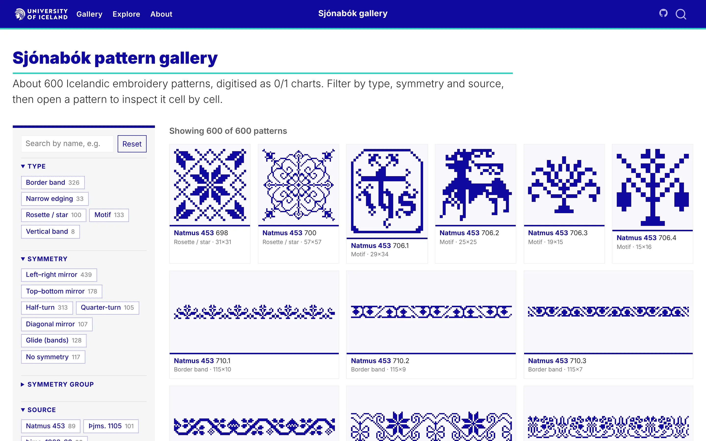

# Sjónabok

## Overview

This open-source project aims to digitize and transform Icelandic medieval patterns from the Sjónabók, published by Heimilisiðnaðarfélagið, into a simple matrix format suitable for machine knitting projects, specifically for HiDef Textiles. The Sjónabók is a treasure trove of historical designs that offer a glimpse into Icelandic artistic heritage.

### About Sjónabók and Heimilisiðnaðarfélagið

The Sjónabók, published by Heimilisiðnaðarfélagið, is a collection of Icelandic medieval patterns that have been meticulously compiled and preserved. Heimilisiðnaðarfélagið, known in English as the Icelandic Home Crafts Association, is dedicated to preserving and promoting traditional Icelandic handcrafts. The book includes an accompanying CD containing .eps figures of these patterns, making them accessible for modern digital projects.

## Project Objectives

1. **Digitize Patterns**: Convert .eps figures from the Sjónabók CD into a simple matrix format.
2. **Open Source Contribution**: Make the digitized patterns available as an open-source resource.
3. **Facilitate Machine Knitting**: Enable the use of these historical patterns in contemporary machine knitting projects by HiDef Textiles.

## Attribution

This project acknowledges and attributes the following institutions for their invaluable resources and support:

- **Heimilisiðnaðarfélagið (Icelandic Home Crafts Association)**
- **Listaháskóli Íslands (Iceland University of the Arts)**
- **Þjóðminjasafnið (The National Museum of Iceland)**

## Requirements

The project uses a simple Python program for converting the patterns. The required packages are listed in the `requirements.txt` file.

## File Format
To ensure efficient storage, the patterns are stored as matrices of 1s and 0s in text files. This format is chosen for its simplicity and small file size.

## Usage
With the path to the Sjonabok folder the program can be run with the following line:
```
python3 convert_to_txt.py <path_to_eps_file> <path_to_txt_file>
python3 convert_to_png.py <path_to_txt_file> <path_to_png_file>
python3 split_pattern.py --cols_distance <int> --rows_distance <int> <path_to_txt_file> 
```
use `--help` to see the options for each program. To convert all files in a folder:
```
make init
make all 
```
Note, you might need to rename the path of the `EPS_DIR` folder in the Makefile.

## Gallery website
The `gallery/` folder holds a [Quarto](https://quarto.org) website for browsing and inspecting the patterns,
with the same look as the [HiDef textíll site](https://hideftextiles.github.io/). It is published at
<https://hideftextiles.github.io/Sjonabok/> by the GitHub Action in `.github/workflows/gallery.yml`.

```
make gallery-data      # measure each pattern, draw PNGs in the HI palette (gallery/patterns/)
make gallery           # build the site into gallery/_site
make gallery-preview   # live preview while editing
```

`gallery/scripts/build_gallery.py` computes the attributes used by the filters (type, mirror and turn
symmetry, frieze or point group, repeat, size, density, pieces, longest float). Generated files are not
committed. `gallery/scripts/sync-theme.sh` refreshes the shared styles from the main site.



### Repeat units

`make repeats` writes one repeat unit per border band to `patterns/repeat/<name>.txt` and a manifest,
`patterns/repeats.csv` (`name, kind, axis, period, phase, copies, status, mismatch`). The phase is the
column (or row, for vertical bands) in the original chart where a clean unit starts. The unit is a
majority vote over all full copies; `status` is `ok` when at most 2% of cells differ from the ideal
repeat, `check` up to 6%, `none` when no repeat was found. These files are committed so other
projects (such as pattern-synthesis) can use them.

The patterns are centuries old and in the public domain. Please credit *Íslensk sjónabók*
(Heimilisiðnaðarfélag Íslands, Listaháskóli Íslands, Þjóðminjasafn Íslands, 2009) and HiDef Textiles.

## License
This project is licensed under the [GNU General Public License v3.0](LICENSE), allowing for open collaboration and distribution.
