## Íslensk sjónabók

*Íslensk sjónabók: Ornaments and Patterns Found in Iceland* (2009) was published jointly by
[Heimilisiðnaðarfélag Íslands](https://www.heimilisidnadur.is/) (the Icelandic Handcraft
Association), [Listaháskóli Íslands](https://www.lhi.is/) (Iceland University of the Arts) and
[Þjóðminjasafn Íslands](https://www.thjodminjasafn.is/) (the National Museum of Iceland). It
reproduces embroidery patterns from ten Icelandic pattern books of the 17th to 19th centuries, and
it comes with a CD of the charts as `.eps` figures.

::: {.heimild}
The patterns are centuries old and in the **public domain**. Please credit the source when you use
them: *Patterns from Íslensk sjónabók (Heimilisiðnaðarfélag Íslands, Listaháskóli Íslands,
Þjóðminjasafn Íslands, 2009), digitised by HiDef Textiles.* Where you can, also name the
manuscript or museum number shown with each pattern.
:::

## The digital charts

[HiDef Textiles](https://hideftextiles.github.io/), a research project at the University of
Iceland, converted the CD figures into plain text matrices so they can be used on knitting
machines and in other design work. Each pattern is a text file with one line per row, `1` for a
filled cell and `0` for an empty one. Pages with several patterns were split automatically, and
those parts carry a `_p1`, `_p2`, … suffix. The splitting is heuristic and sometimes cuts or merges
a motif.

The file name starts with the source: the manuscript or museum number the pattern comes from,
for example `thjms5898` for Þjms. 5898 at the National Museum of Iceland. The number after it
is the page in *Íslensk sjónabók* (2009), so `natmus453_706_p4` is the 4th motif on page 706. A page often holds several motifs; the `_p` numbering is ours, from splitting the page, not from the book.

The charts, the converters and this gallery live in the
[HiDefTextiles/Sjonabok](https://github.com/HiDefTextiles/Sjonabok) repository. Every pattern in
the gallery can be downloaded as its `.txt` chart or as a PNG image.

## Printed European pattern books {#books}

Next to the Icelandic manuscripts the gallery holds charts from **printed pattern books** of the
16th and 17th centuries, filter *Collection: European printed books*. These books were sold all
over Europe, and their designs were copied from book to book: the museum records note that
Quentel's patterns (Cologne, 1527 onwards) closely copy Schönsperger's (Augsburg), that Jobin
(Strasbourg, 1579 onwards) copies Vavassore, Pagano, Quentel and others, and that Sibmacher's
first title follows Jobin. They are one of the routes by which patterns could have reached Iceland.

| Book | Printed | Held by | Charts so far |
|---|---|---|---|
| *Eyn New Kunstlichboich* | Peter Quentel, Cologne 1529 (first ed. 1527) | The Met, 20.50.2(1-49) | 26 |
| *Ein new getruckt model Büchli* | Johann Schönsperger the Younger, Augsburg 1529 | The Met, 18.66.2 | 62 |
| *Modelbuch aller art nehens und stickens* | Christian Egenolff, Frankfurt 1535 | The Met (scans on [archive.org](https://archive.org/details/Egenolff1535ModelbuchAllerMET)) | 2 |
| *Modelbuch new aller art nehens und stickens* | Hermann Gülfferich, Frankfurt 1553 (first ed. 1545) | The Met (scans on [archive.org](https://archive.org/details/Gulfferich1553ModelbuchMET)) | 27 |
| *Eyn newe kunstlich moetdelboech* | Peter Quentel, Cologne 1532 | The Met (scans on [archive.org](https://archive.org/details/Quentel1532EynNeweMET)) | 8 |
| *Ce est ung tractat de la noble art de leguille* | Willem Vorsterman, Antwerp 1527 | The Met (scans on [archive.org](https://archive.org/details/VostermanAf1527CeEstUngMET)) | 40 |
| *Eyn new kunstlich Modelbuech* | Peter Quentel, Cologne 1544 | BnF Gallica (copy on [archive.org](https://archive.org/details/quentell-1544-eyn-new-kuenstich-bnfbpt-6k-1510823d)) | 1 |
| *Schön newes Modelbuch* | Sigismund Latomus, Frankfurt 1608 | The Met, 24.43 (scans on [archive.org](https://archive.org/details/Latomus1608SchonMET)) | 82 |
| *Schön neues Modelbuch* | Jost Martin, Strasbourg 1599 | Library of Congress (scans on [archive.org](https://archive.org/details/martin1599schonloc)) | 51 |
| Giovanni Antonio Tagliente, *Essempio di recammi* | Venice 1530 (first ed. 1527) | The Met, 35.75.3(1-55) | 12 |
| *New Künstlichs Modelbuch* | Bernhard Jobin, Strasbourg 1600 (first ed. 1579) | The Met, 19.158(1-48) | 88 |
| Johann Sibmacher, *Schön Neues Modelbuch* | Balthasar Caymox, Nuremberg 1597 | The Met, 20.16(1-43) | 35 |
| Johann Sibmacher, *Newes Modelbuch in Kupffer* | Nuremberg 1604 (first ed. 1601) | The Met, 29.59.3(1-70) | 26 |
| Rosina Helena Fürst, *Das Neue Modelbuch*, parts I–IV | Paulus Fürst, Nuremberg, about 1660 to 1689 | Clark Art Institute (scans on [archive.org](https://archive.org/details/modelbucht1400frst)); part I also at the Met, 28.45.5 | 189 |

More books are listed in [`books/books.csv`](https://github.com/HiDefTextiles/Sjonabok/blob/main/books/books.csv)
with their places, dates, holders and rights. Fürst is the closest of these books in time to the Icelandic manuscripts; her charts draw outlines solid and fillings hatched, and some plates are drawn on a net turned 45 degrees (read as a square grid here). The Frankfurt books (Egenolff, Gülfferich) were photographed with the page bending, so their
cut-out squares are followed cell by cell ([`books/warped.py`](https://github.com/HiDefTextiles/Sjonabok/blob/main/books/warped.py)).
Most of their other plates, and all of Hans Hoffmann's *New Modelbuch* (Strasbourg 1556), are interlace and
scrollwork drawn freely, not on a grid, so they are not counted. Alphabets found in the books are not added here: they go to the [Sjónabók alphabets](https://github.com/HiDefTextiles/Sjonabok-stafrof) project.

**Rights.** The books are in the public domain and the museum scans are marked public domain
(The Met Open Access). We do not copy the scans into the repository; each chart links to the
museum record. The charts in the gallery are read from the scans by us: they are our
interpretation, released under **CC BY 4.0**. Credit: *Helga Ingimundardóttir, Háskóli Íslands
(HiDef Textiles)*, and name the book.

**How the charts are read.** A script finds each ruled chart on a scanned page, straightens it,
finds the grid lines and calls a cell filled when its centre is inked
([`books/digitise.py`](https://github.com/HiDefTextiles/Sjonabok/blob/main/books/digitise.py)).
Most of the earlier woodcuts (Quentel, Schönsperger, Tagliente, Jobin) are cut the other way round, a black block with the empty cells cut out as
white squares, so they have their own reader that follows the white squares
([`books/woodcut.py`](https://github.com/HiDefTextiles/Sjonabok/blob/main/books/woodcut.py)).
Every chart was checked by eye against the scan; plates drawn with several symbols (crosses,
wheels, shaded cells) or badly printed are left out for now (`redo` in
[`books/charts.csv`](https://github.com/HiDefTextiles/Sjonabok/blob/main/books/charts.csv)).
Are any of them in colour? The woodcuts are strictly two-tone. Sibmacher's etchings are not:
of the 65 readable plates left out, 40 use more than solid cells, 24 a hatched second tone and
26 wheels or star cells (most likely a stitch, such as an eyelet, rather than a colour), and almost
all add small crosses. The books print no key, so which symbol is a colour and which a stitch is our
reading, not the author's ([`books/symbols.csv`](https://github.com/HiDefTextiles/Sjonabok/blob/main/books/symbols.csv)).
Charts marked *fair* may have a few wrong cells. The number in a book chart's file name is the
plate (or leaf) of the book, `_p` the band on that plate.

**Do patterns travel?** [`books/travel.py`](https://github.com/HiDefTextiles/Sjonabok/blob/main/books/travel.py)
looks for whole figures (at least 10 cells, free on all sides) that occur both in a printed book
and in an Icelandic manuscript, allowing turns, mirroring and a cell of difference. The figures
it finds are shown on the [map and timeline](map/web/europe.html). For example a 17×17 eight-pointed
star is cell for cell the same in Sibmacher's book of 1597 and in Þjms. 1105 (17th century).
A shared figure does not prove copying, since simple geometric figures can be invented twice,
but large identical figures and the dates make a printed source likely.

## How the gallery is made

On every change to the repository a GitHub Action:

1. reads all charts in `patterns/min/`,
2. measures each one (size, density, symmetry, repeat, separate pieces, longest float) and
   sorts it into a type: border band, narrow edging, rosette / star, motif or vertical band,
3. draws PNG images in the colours of the University of Iceland
   ([HÍ palette](https://honnun.hi.is/)): HI blue on a transparent background,
4. renders this site with [Quarto](https://quarto.org/) and publishes it on GitHub Pages.

You can run the same steps locally with `make gallery` (or `make gallery-preview`). The measures
are computed, not curated, so treat them as a guide for browsing.

## Measures in brief

| Measure | Meaning |
|---|---|
| Pattern size | Width × height after the empty margin is trimmed |
| Density | Share of filled cells within the trimmed pattern |
| Left–right / top–bottom mirror | The pattern matches its mirror image (at least 98% of cells) |
| Half-turn, quarter-turn | The pattern matches itself turned 180° or 90° |
| Diagonal mirror | A square pattern matches its mirror across a diagonal |
| Glide | A band matches itself flipped top to bottom and shifted half a repeat |
| Repeat | Smallest shift along a band after which it repeats; *checked* means up to 2% of cells differ from a perfect repeat |
| Symmetry group | A short code for all the symmetry together: a *frieze group* for bands (p1, p11g, p1m1, p2, p2mg, p11m, p2mm), a *point group* for motifs (C1, D1, C2, D2, C4, D4). See [Symmetry in plain words](#symmetry) |
| Separate pieces | Number of shapes of filled cells; cells touching at a corner count as joined |
| Longest float | Longest run of filled (or empty) cells in one row |

## Symmetry in plain words {#symmetry}

A pattern has *symmetry* when you can move it and it still looks the same. Four moves are used:

- **Shift**: slide the pattern along. Every border band does this, because it repeats.
- **Mirror**: flip the pattern over a line, as in a mirror. The two sides of the line match.
- **Turn**: turn the pattern around a point. A *half-turn* is 180° (upside down), a
  *quarter-turn* is 90°.
- **Glide**: mirror the pattern top to bottom *and* slide it half a step along, like
  footprints in the snow: left, right, left, right.

The gallery sums up which of these moves leave a pattern unchanged in a short code, the
*symmetry group*. The codes are the standard names that mathematicians and textile scholars use,
so you will find them in books on pattern and ornament too.

The pictures below show each code with the letter F, which has no symmetry of its own, so
every copy shows the move that made it. On the pictures:

::: {.sym-key}
[]{.k-mirror} mirror line &emsp; []{.k-glide} glide line &emsp; []{.k-turn} turning point
:::

### Bands: the seven frieze groups {#frieze-groups}

A band repeats in one direction, so it always has the shift. There are only seven ways to
combine that shift with mirrors, turns and glides, so every band is one of these seven
*frieze groups*. They are described here for a band running left to right; a vertical band is
read as if it were turned on its side.

::: {.sym-cards .sym-bands}

::: {.sym-card}
{fig-alt="A row of the letter F, all facing the same way."}

**p1**: repeats only. Every copy faces the same way, with no mirror and no turn.
:::

::: {.sym-card}
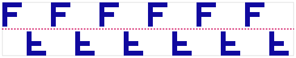{fig-alt="F above the middle line alternates with an upside-down mirrored F below it, half a step further along."}

**p11g**: glide. Each copy is flipped top to bottom and moved half a step along,
like footprints.
:::

::: {.sym-card}
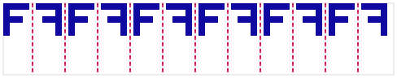{fig-alt="F and its mirror image alternate, separated by upright mirror lines."}

**p1m1**: mirror lines across the band. Each motif, or each pair of motifs, is the same on
its left and right side.
:::

::: {.sym-card}
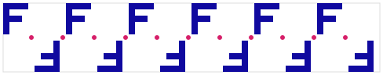{fig-alt="F above alternates with F turned upside down below, with turning points between them."}

**p2**: half-turns. Turn the band upside down and it looks the same, but nothing is
mirrored. Look for S- or Z-shaped running motifs.
:::

::: {.sym-card}
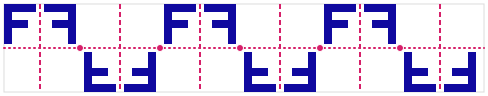{fig-alt="A mirrored pair of F above alternates with a mirrored pair of upside-down F below."}

**p2mg**: mirror lines across the band and a glide. Mirrored pairs take turns above and
below the middle, often as a zigzag.
:::

::: {.sym-card}
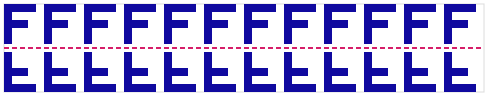{fig-alt="A row of F with its upside-down mirror image directly below, mirrored over the middle line."}

**p11m**: one mirror line along the middle. The top half of the band mirrors the
bottom half.
:::

::: {.sym-card}
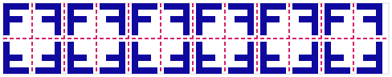{fig-alt="F mirrored both across and along the band, four copies to each repeat."}

**p2mm**: mirror lines across *and* along the band. The most symmetric band: each motif is
mirrored left to right and top to bottom.
:::

:::

**Reading the code.** *p* is a pattern that repeats. The first figure tells whether the band
has half-turns (*2*) or not (*1*). The next letter is about lines across the band and the last
about the line along its middle: *m* is a mirror, *g* a glide, and *1* means nothing there.
*p2* is short for *p211*.

### Motifs: point groups {#point-groups}

A single motif or rosette does not repeat, so it can only be turned around its centre or
mirrored over lines through its centre. Its *point group* has a letter and a number:

- **C** (cyclic) means turns only, no mirror. **D** (dihedral) means turns *and* mirror lines.
- The **number** is how many ways round the motif looks the same in one full turn:
  *1* only the way it is, *2* also upside down (a half-turn), *4* also on its side (quarter-turns).
  For D, it is also the number of mirror lines.

::: {.sym-cards .sym-motifs}

::: {.sym-card}
{fig-alt="A single hook shape."}

**C1**: no symmetry. The motif only matches itself as it is.
:::

::: {.sym-card}
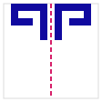{fig-alt="A hook and its mirror image on either side of an upright line."}

**D1**: one mirror line, like a heart, a bird seen head on or a tree.
:::

::: {.sym-card}
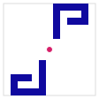{fig-alt="A hook and the same hook turned upside down, around a central point."}

**C2**: half-turn only. Same upside down, but not mirrored, like the letters S and N.
:::

::: {.sym-card}
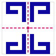{fig-alt="Four hooks mirrored over an upright and a level line."}

**D2**: two mirror lines at right angles, and so also a half-turn, like the letter H.
:::

::: {.sym-card}
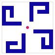{fig-alt="Four hooks, each turned a quarter from the last, like a pinwheel."}

**C4**: quarter-turns, no mirror. A pinwheel that seems to spin one way.
:::

::: {.sym-card}
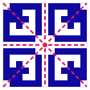{fig-alt="Eight hooks forming a square star with four mirror lines."}

**D4**: quarter-turns and four mirror lines (upright, level and both diagonals). The square
stars and rosettes.
:::

:::

In the gallery a mirror line of a motif may be upright, level or diagonal; D1 just says there
is one. C4 and D4 are only possible for square motifs.

### How to use it

- In the [gallery](index.qmd), open *Symmetry group* in the filters and pick a code. Hold the
  pointer over a code to see what it means.
- The [Explore](explore.qmd#symmetry) page counts how many patterns have each code; click a bar
  to see them.
- Symmetry is measured by the computer. A mirror or turn counts when at least 98% of the cells
  match, so a small slip in the drawing does not spoil it, but a pattern drawn with deliberate
  small variations may get a lower code than it seems to have.

## Repeat units {#repeats}

A border band that repeats exactly is stored as **one repeat unit**: `patterns/min/<name>.txt`
holds one repeat, and the *.txt* download in the pattern view is that unit. The unit is cut
so that a border made of whole units ends cleanly: no stray dots (pieces of four cells or fewer) at
either end, and as few connections between filled cells cut as possible, so motifs are not split. Where
the band has a mirror, the cut is placed so that whole units plus at most one column (the `close`
column in `repeats.csv`) mirror exactly end to end, so the sides of a frame meet each corner the
same way. `patterns/repeats.csv` lists every band with its direction,
repeat length and whether it is stored as a unit. Bands that repeat with a few differing cells, and
bands without a repeat, keep their chart as drawn.

In the pattern view, *Repeat* shows a unit repeated. For a band kept as drawn it shows the chart with
its own starting edge and then continues it from the last full repeat; the dashed line marks where
the chart ends.
A motif or rosette is shown with a one-cell empty margin all round (its *chart size*, the pattern
size + 2), and *Repeat* places copies with a one-cell spacer between them, so neighbouring copies
do not touch. One repeat (the *repeat tile*) is the pattern size + 1 in each direction.

## How "similar patterns" are chosen {#similar}

The similar patterns are picked by a computer from the shapes alone. It does not know what a
motif depicts, so a bird may sit next to a flower that has a similar outline. Treat the list as a
way to browse, not as a classification.

1. **What is compared.** For a band, one repeat unit; for any other pattern, the whole chart with
   its empty margin trimmed. Each is shrunk to a 16 × 16 grey picture.
2. **What is ignored.** A band is tried in all positions along its repeat and mirrored left–right
   and top–bottom, so two bands that start at different places in the repeat, run the other way
   or are mirror images still match. A motif is tried in all eight turned and mirrored positions.
   Vertical bands are laid horizontally first, so they can match horizontal ones.
3. **Score.** The best match over those positions (a correlation between the two pictures), with
   small deductions when the overall shape (width to height of the unit) or the share of filled
   cells differs, and a small bonus for the same family (bands with bands, motifs with motifs).
4. **Result.** The eight highest scores are shown.

Known limits: the repeat length itself is not compared, so a small unit and a large unit with
the same outline look alike; the 16 × 16 picture loses fine detail; and a filled/empty swap of the
same pattern is not matched.
