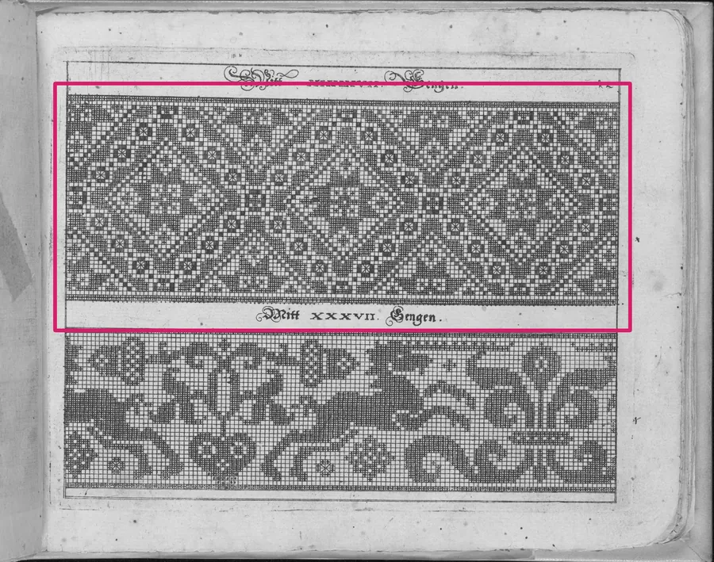
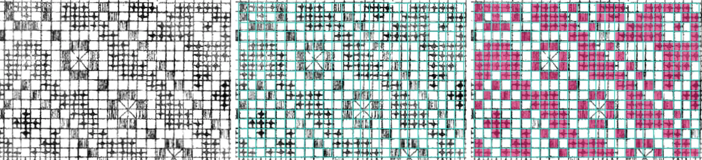
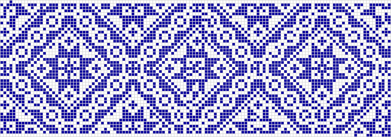
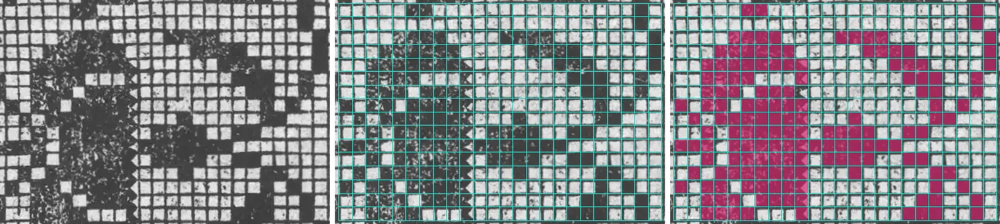
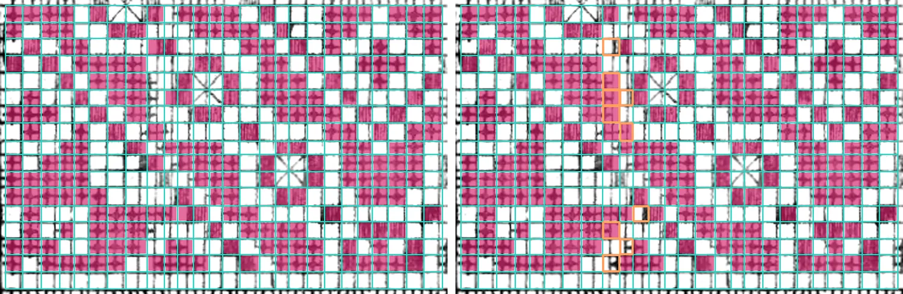

Every old pattern book draws its patterns in its own way. Some print a neat grid of squares with a
cross or a dot in each filled square. Some cut the pattern out of a black wooden block, so the
empty squares are the white ones. Some use a different symbol for each colour, and some are only
line drawings. We do not want a new, separate method for every book, so we use one common recipe
that we call a **pattern source**.

Think of a pattern source as a translator with one job: take any page and hand back the same
thing every time, a chart of 0s and 1s plus a label saying where it came from. Once a pattern is
in that form, every tool in this gallery works on it, whatever book it came from.

::: {.callout-note appearance="simple"}
The pictures on this page are made from scans of two books in The Metropolitan Museum of Art,
New York, which the museum releases as public domain (Met Open Access, CC0). The charts were read
by the same scripts that made the charts in the gallery, and the pictures are checked against
them cell for cell.
:::

## What every pattern source can do

Whatever the book, a pattern source does the same three things:

```
every PatternSource can:
    read(page)        -> the charts it finds on that page
    chart.cells       -> rows of 0 and 1
    chart.provenance  -> book, year, place, holder, licence
```

Each kind of book then adds only what is special about it:

```
RuledGridSource (a ruled grid, a mark in each filled square):
    find the grid lines, then: inked centre -> 1, empty centre -> 0

WhiteLineWoodcutSource (white squares cut out of a black block):
    no lines are printed, so find the grid from the white squares,
    then: dark square -> 1, white square -> 0

MultiSymbolPlateSource (a different symbol for each colour):
    ask which symbol is "pattern" and which is "background"

LineDrawingSource (outlines only):
    draw the outline, fill the inside, then read the squares
```

These are the names used in the code
([`books/sources/`](https://github.com/HiDefTextiles/Sjonabok/tree/main/books/sources)). The
first two read the books in the gallery today; the last two are for books we have not read yet.

## One page, step by step

This page is plate 12 of Johann Sibmacher's *Schön Neues Modelbuch*, etched in copper and printed
in Nuremberg in 1597. Each plate shows one or two border bands on a ruled grid.

{fig-alt="A printed page with two wide embroidery bands on a fine grid. The upper band, a lattice of diamonds, is outlined in pink."}

**1. Find the patterns on the page.** Charts are evenly dense areas of ink, while titles,
page numbers and margins are not. That finds the two bands. The page is also straightened a
little, because no page lies perfectly flat under the camera.

**2. Find the grid.** The ruled lines repeat at an even spacing, and the squares are square. Once the spacing is known, the lines are followed one by one across the band, so a
small stretch in the paper does not throw the count off.

**3. Read each square.** We look only at the middle of every square, away from the ruled lines,
and ask: is there ink here? Inked squares become 1, empty squares 0. The line between "inked"
and "empty" is set from the band itself, so a lightly printed plate is read as fairly as a dark
one.

{fig-alt="Three copies of the same enlarged piece of the printed grid. The middle copy has teal grid lines drawn over it, the right copy also has the filled squares coloured pink."}

**4. Hand back the chart.** The result is a plain text file with one line per row. These are the
first five rows of the enlarged piece above, exactly as they are stored:

```
1 1 1 1 1 0 1 1 1 0 1 0 0 1 1 1 0 0 1 1 1 1 1 0
1 0 1 0 1 0 1 1 1 1 0 1 0 1 1 1 0 1 1 1 0 0 1 1
0 1 1 1 0 0 0 1 1 1 1 0 1 0 0 0 1 1 1 1 0 1 0 1
0 0 0 0 0 1 0 0 0 0 1 1 0 0 0 1 1 1 1 1 0 0 0 1
0 1 1 1 0 0 0 1 1 0 0 1 1 0 1 0 0 0 0 1 1 1 1 1
```

and the whole band, 45 rows by 128 columns:

{fig-alt="A wide band of blue squares on white forming a lattice of diamonds with small crosses."}

In the code, those four steps are one line each:

```
source = RuledGridSource(plate 12, book="sib1597")
band   = source.read()[0]           # the upper band
band.cells                          # 45 rows of 128 zeros and ones
band.provenance
#   Johann Sibmacher, Schön Neues Modelbuch, Nuremberg 1597,
#   The Metropolitan Museum of Art 20.16(1-43), public domain
```

The chart is stored as `sib1597_12_p1`: book, plate 12, first band on the plate.

## A book that is cut the other way round

Peter Quentel's *Eyn New Kunstlichboich* (Cologne, 1529) was printed from woodblocks. The cutter
left the pattern standing as black wood and cut away the empty squares, so on paper the pattern
is black and the background is a field of small white squares. No grid lines are printed at all.

A ruled-grid reader would be lost here, so this book has its own small translator. It finds the
white squares first, measures how far apart they are, and lays the grid through them. Then a dark
square is 1 and a white one is 0. Woodblocks print unevenly, so each square is compared with the
lightest and darkest squares around it rather than with one rule for the whole page. Everything after that is shared: the result is the same kind
of chart, with the same kind of label.

{fig-alt="Three copies of the same enlarged piece of a black woodcut with small white squares. The middle copy has a teal grid laid through the squares, the right copy has the black squares coloured pink."}

{fig-alt="A tall chart of blue squares on white."}

## Why one recipe helps

Because every book ends up in the same form, adding a new book only needs a new small
translator for whatever is special about its printing. All the rest works on it straight away:
the gallery, the symmetry measures, the repeat units and the search for shared figures. That is
how we found that a 17 × 17 eight-pointed star is cell for cell the same in Sibmacher's book of
1597 and in the Icelandic manuscript Þjms. 1105, from the 17th century (see
[Printed European pattern books](about.qmd#books) and the
[map and timeline](map/web/europe.html)).

## Checking by eye

A reader can be wrong. Faint printing, worn blocks, ink blots and paper that has stretched can
all fool it. Every chart from a printed book is therefore laid over its scan, like the pink
pictures above, and checked by eye before it goes into the gallery. Charts that read well are
marked *good*, charts that may have a few wrong squares *fair*, and plates the reader cannot yet
handle (several symbols, heavy shading or bad printing) are left out until they get their own
translator. The list is in
[`books/charts.csv`](https://github.com/HiDefTextiles/Sjonabok/blob/main/books/charts.csv).

## More than two kinds of square

Look closely at Sibmacher's plate and there are more than two kinds of square. Most filled squares
hold a small **cross**, some are **hatched** with fine upright lines, some have a **diagonal** or
an **X** across them, and the rest are empty. The book prints no key, so we do not know for sure
which mark means a colour and which means a stitch. We read each kind of mark as its own colour:
a solid square, a cross and a hatched square are three different colours, not one. A square cut
by a diagonal, a *triangle within the square*, usually means a half stitch.

The reader on this page only knows "ink" and "no ink", so it has to squeeze every mark into 1 or 0.
Hatched squares are lighter than crossed ones, so some of them come out as 1 and some as 0. That
is a fault in the translator, not in the book. The next step is a translator for plates like this
one that records which mark each square holds. A first version (`NamedMarkPlateSource`, a kind of
`MultiSymbolPlateSource`) gives every square one character: `.` empty, `#` solid, `+` cross, `x`
diagonal cross, `|` and `-` hatching, `/` and `\` single diagonals, half-square triangles, and `?`
for a mark it cannot tell. The colour chart then stores one number per colour instead of just
0 and 1, for example `0` empty, `1` solid, `2` cross, `3` hatched, and the gallery draws each number
in its own HI colour. On plate 12 about 6% of the squares are still `?`, and those are the ones to check
first.

## Reading slips and symmetry

Most bands in these books are drawn with exact symmetry: they repeat along their length and are
mirrored left to right, often top to bottom too. A reading slip breaks that symmetry in a single
square, while the design itself does not. So for every chart we look for the symmetries that hold
in at least 95% of its squares. Then we compare each square with all the squares the symmetries
match it to. When three out of four or more of those squares disagree with it, it is taken as a
reading slip and changed to agree with them.

{fig-alt="Two copies of the same enlarged piece of the band with filled squares in pink. On the right, about ten squares in one column are outlined in orange where the reading was changed."}

The edits are listed one by one in
[`books/corrections.csv`](https://github.com/HiDefTextiles/Sjonabok/blob/main/books/corrections.csv)
with the value that was read, so they can always be undone. A chart with many disagreeing squares
is not edited. It is marked for review, because there the "symmetry" may not really be part of
the design. The check is
[`books/slips.py`](https://github.com/HiDefTextiles/Sjonabok/blob/main/books/slips.py).

::: {.heimild}
The charts read from printed books are our interpretation of the scans and are released under
**CC BY 4.0**. Credit: *Helga Ingimundardóttir, Háskóli Íslands (HiDef Textiles)*, and name the
book. The books and the Met scans are in the public domain. The readers are
[`books/digitise.py`](https://github.com/HiDefTextiles/Sjonabok/blob/main/books/digitise.py)
(ruled grids) and
[`books/woodcut.py`](https://github.com/HiDefTextiles/Sjonabok/blob/main/books/woodcut.py)
(woodcuts); the pictures on this page are made by
[`gallery/scripts/reading_examples.py`](https://github.com/HiDefTextiles/Sjonabok/blob/main/gallery/scripts/reading_examples.py).
:::
